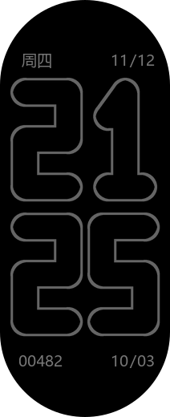

# 小米手环 10 表盘作品集

点击项目名称查看功能、操作与安装说明。

| 项目 | 亮屏 | 息屏 |
| --- | --- | --- |
| [只有数字](digits/README.md)<br>六色配色与中央快捷入口 |  |  |
| [只有情绪](emotion/README.md)<br>真实压力换色与体感漂移 |  |  |
| [像素火焰](pixel-flame/README.md)<br>火星交互、换色换形与体感开关 |  |  |

每款项目使用同一目录结构。

```text
项目目录/
├── README.md
├── downloads/          安装包
├── previews/
│   ├── active.png      亮屏预览
│   └── aod.png         息屏预览
└── checksums.sha256    安装包校验码
```

适配目标为小米手环10 NFC，型号 M2456B1，澎湃OS 3.1.28。各项目分别记录已验证功能和待确认项。

预览统一为212 × 520像素，四角透明，按手环胶囊轮廓裁剪。时间和附属数据为示例，实机内容随设备数据更新。
