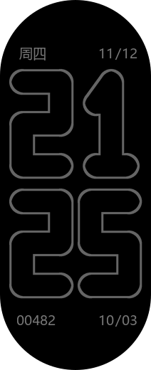

# 体感情绪光团表盘

| 亮屏 | 息屏 |
| --- | --- |
|  |  |

## 功能

- 读取手环提供的实际压力值，自动切换光团颜色。
- 1–20柔绿，21–40青蓝，41–60琥珀，61–100珊瑚红，无有效读数时柔白。
- 倾斜手环，光团缓慢漂移。
- 息屏保留轮廓时间、星期、阳历、步数和农历位置。

## 操作

- 佩戴后由系统提供压力读数，更新频率由固件决定。
- 双击中央临时预览下一种颜色，约6秒后回到当前压力对应颜色。
- 倾斜手环观察光团移动。

## 下载与安装

[下载表盘安装包](downloads/mood-gravity-refined.bin)

下载 .bin 后，通过你使用的第三方蓝牙表盘工具安装。

## 真机记录

测试设备为小米手环10 NFC，型号 M2456B1，澎湃OS 3.1.28。

用户已确认真实压力值能够驱动颜色变化，并确认此体感版基本过关。

## 已知情况

高亮度下可能有轻微色阶，体感流畅度仍有优化空间。中央直达系统压力尚未实现。息屏农历绑定的独立验收尚未记录。

## 文件说明

- downloads 保存安装包。
- previews 保存212 × 520透明胶囊轮廓预览。
- checksums.sha256 用于核对安装文件完整性。

预览依据本项目包内素材生成。时间及附属数据为排版示例，真机内容随设备数据更新。
